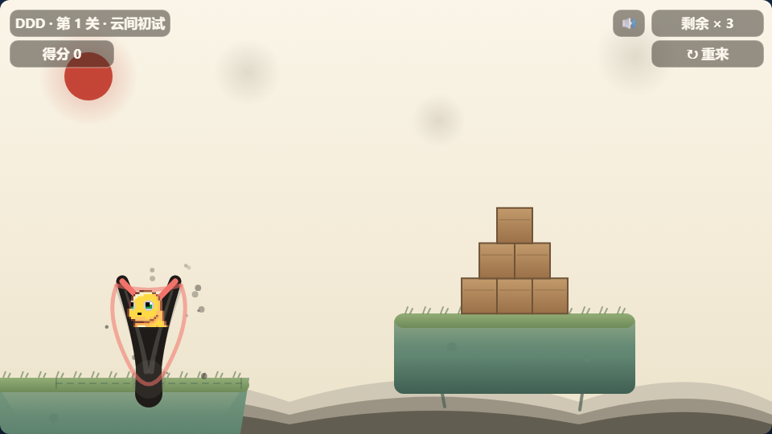
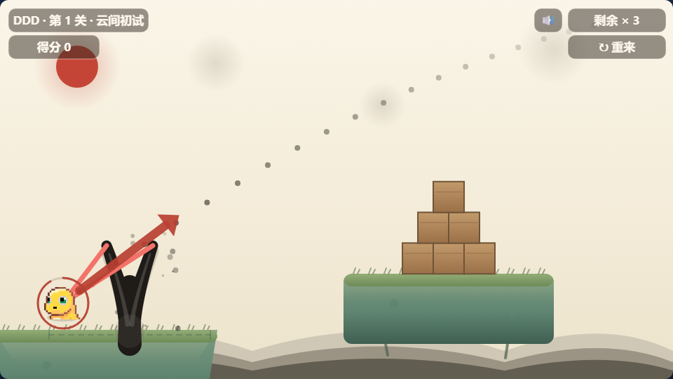

# DDD

> 拖动奶龙拉满弹弓，把浮空岛上堆叠的木块全部击倒。
> 四关闯关 · 水墨国风 · 纯静态零依赖。

| 准备发射 | 拉弓瞄准 |
|---|---|
|  |  |

## 玩法

木块**没有血条** —— 被撞得掉下岛、翻倒（超过约 40°）或横向挪位超过 45px 就算「**击倒**」，
把一关的木块全部击倒即通关。每关给定奶龙发数，**剩余发数决定星级**。

| 关卡 | 名称 | 奶龙 | 木块 | 浮空岛 |
|---|---|---|---|---|
| 1 | 云间初试 | 3 | 6 | 1 座 |
| 2 | 叠叠高 | 3 | 9 | 2 座（一低一高） |
| 3 | 一柱擎天 | 4 | 10 | 1 座四层高塔 |
| 4 | 巅峰论道 | 5 | 16 | 2 座高塔 |

## 操作

| 操作 | 效果 |
|---|---|
| 拖动奶龙往后拉 → 松手 | 发射。拉得越满越远，松手前会显示**弹道预演虚线**和**力度箭头** |
| 拉不到 30px 就松手 | **取消发射**，奶龙弹回皮兜，不扣发数 |
| 拖动**弹弓的叉尖或手柄** | 弹弓在发射台上**左右平移**（奶龙跟着皮兜走） |
| 右上角 🔊 / 🔇 | 静音开关 |

## 怎么跑

纯静态，**不需要任何构建步骤、也没有网络依赖**（Matter.js 已内联在 `ggame/lib/` 里）。

```bash
# 直接用浏览器打开
ggame/index.html
```

## 技术要点

- **物理**：[Matter.js](https://brm.io/matter-js/)，960×540 世界，`gravity.scale = 0.001`，固定 60Hz 步进。
  世界**没有地面也没有墙** —— 浮空岛是唯一的支撑体，没接住的东西会直接掉出画面。
- **水墨渲染全部用 canvas 手绘**，没有引入任何位图素材：宣纸底、朱砂太阳、三层淡墨远山、
  青绿山石浮空岛（苔草 / 苔点 / 垂藤）、赭木块、以及用变宽笔触画的墨笔弹弓 + 珊瑚红皮筋。
- **弹道预演与真实轨迹完全一致**：预演不是近似抛物线，而是照引擎的真实积分公式逐步推演
  （`gravity.y × gravity.scale × dt²`，并乘上 `frictionAir` 阻尼），与真实飞行路径偏差 `0.000px`。
- **下坠加重力**：奶龙一旦进入下坠（`vy > 0`）就额外施加 30% 重力，让高抛弧线「压」下来。
  刻意不去改 `engine.gravity` —— 那样木块会跟着一起变重。
- **撞击威力**：奶龙下坠中命中木块时补一份冲量（`IMPACT_BOOST = 2.0`），
  而且**只推木块、从不碰奶龙**，所以出手弧线与落点在开启前后完全一致。
- **音效全部是实时合成**的 WebAudio，没有音频文件：噪声音源 + 低通做木质闷响，
  扫频拨弦做发射，四音琶音做通关。

## 目录结构

```
.
├── README.md
├── docs/                          截图
└── ggame/
    ├── index.html                 页面骨架 + DOM 覆盖层（开始 / 通关 / 失败弹窗）
    ├── style.css                  覆盖层、按钮、弹窗、星级动画
    ├── game.js                    全部游戏逻辑与渲染（单文件，约 1200 行）
    ├── lib/matter.min.js          物理引擎（离线内联，无 CDN 依赖）
    ├── assets/                    奶龙精灵图、通关视频
    ├── design-scene.html          场景重设计图（水墨国风）
    ├── design-levels.html         四关布局设计图
    ├── design-collision-l3.html   第 3 关碰撞体积图纸
    └── DEVELOPMENT-LOG.md         开发日志
```

## 设计图与文档

三份图纸都是可直接打开的单文件 HTML：

- [`ggame/design-scene.html`](ggame/design-scene.html) —— 场景重设计（水墨国风的配色与元素）
- [`ggame/design-levels.html`](ggame/design-levels.html) —— 四关布局，含弹道示意
- [`ggame/design-collision-l3.html`](ggame/design-collision-l3.html) —— 第 3 关碰撞体积图纸，
  画出每个碰撞体的实际形状、坐标范围、质量与物理参数，以及弹弓的拖拽可达范围

开发过程、每次改动的原因、关键常量和踩过的坑都记在
[`ggame/DEVELOPMENT-LOG.md`](ggame/DEVELOPMENT-LOG.md)。
